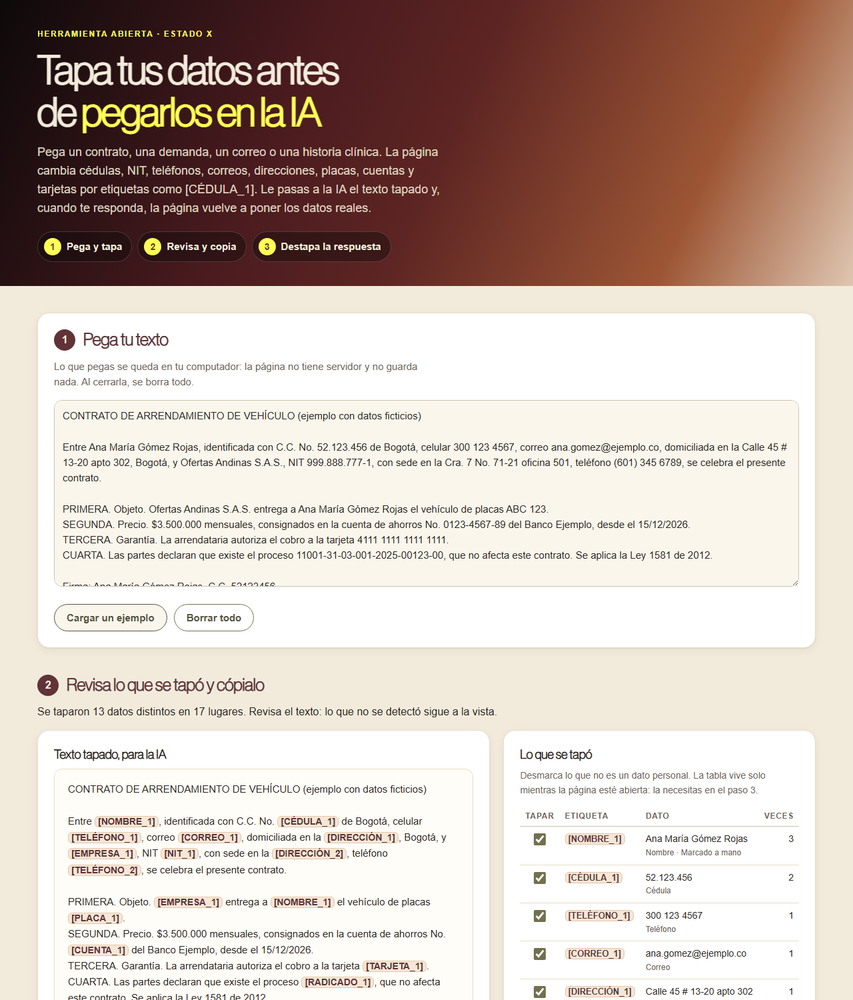

# Tapa tus datos antes de pegarlos en la IA

**[Español](#español) · [English](#english)**

## Español

Herramienta abierta para **tapar los datos personales de un texto antes de pegarlo en ChatGPT, Claude, Gemini o cualquier IA**, y para **volver a poner los datos reales** en la respuesta. Sirve para contratos, demandas, correos, historias clínicas o cualquier documento con datos de otras personas.

**Ábrela aquí:** https://estado-x.github.io/tapa-tus-datos-colombia/

### Qué hace

1. **Pegas el texto** y la página cambia cada dato por una etiqueta numerada. El mismo dato siempre recibe la misma etiqueta, aunque esté escrito distinto (52.123.456 y 52123456 son `[CÉDULA_1]`).
2. **Revisas** el texto tapado y la tabla de lo que se tapó. Desmarcas lo que no es un dato personal y marcas a mano lo que falte (nombres de personas, empresas). Copias el texto tapado y lo pegas en la IA.
3. **Pegas la respuesta de la IA** y la página cambia cada etiqueta por el dato real, aunque la IA la escriba sin tilde, en minúsculas o sin corchetes. Te avisa si aparece una etiqueta que no está en la tabla.

| Dato | Etiqueta | Cómo lo reconoce |
|---|---|---|
| Cédula | `[CÉDULA_1]` | Con puntos, con espacios o sin separador, cuando el texto dice «cédula», «C.C.», «C.E.» o «identificado con» |
| Tarjeta de identidad, pasaporte, PPT | `[DOCUMENTO_1]` | Cuando el texto lo nombra |
| NIT | `[NIT_1]` | Con dígito de verificación comprobado (módulo 11 de la DIAN). Si el texto dice «NIT», se tapa aunque el dígito no cuadre, con aviso |
| Teléfono | `[TELÉFONO_1]` | Celulares (3XX), fijos de 10 dígitos (601 a 608) y con +57; números de 7 dígitos si dicen «Tel.» |
| Correo | `[CORREO_1]` | Cualquier correo electrónico |
| Dirección | `[DIRECCIÓN_1]` | Calle, Cra., Av., Transversal, Diagonal, Circular… con # o No. y guion, más apto, oficina, torre o local |
| Placa | `[PLACA_1]` | Carro (ABC 123) y moto (ABC 12D) |
| Cuenta bancaria | `[CUENTA_1]` | Cuando el texto dice «cuenta de ahorros», «corriente» o «número de cuenta» |
| Tarjeta | `[TARJETA_1]` | De 13 a 19 dígitos que pasan la prueba de Luhn |
| Radicado judicial | `[RADICADO_1]` | Número de 23 dígitos, con o sin guiones |
| Marcado a mano | `[NOMBRE_1]`, `[EMPRESA_1]`, `[DATO_1]` | Se busca en todo el texto, sin importar mayúsculas ni tildes |

Lo que **no** tapa: fechas, montos en pesos, porcentajes, números de leyes, decretos, sentencias ni artículos. Las pruebas lo revisan con casos de control.

### Cómo funciona

- Es una página estática (HTML, CSS y JavaScript) publicada con GitHub Pages. No tiene servidor ni base de datos, no necesita claves y **no envía a ningún lado** lo que pegas.
- **La tabla para destapar vive solo en la memoria de la página.** No se guarda en el navegador ni en ningún lado: si cierras o recargas la página, se pierde.
- `assets/tapar.js` tiene la detección, el tapado y el destapado; `assets/app.js` es la interfaz; `assets/ejemplo.js`, el texto de ejemplo con datos ficticios (también el NIT). Las pruebas, en `pruebas/`, revisan el dígito de verificación con NIT públicos (DIAN 800.197.268-4 y SIC 800.176.089-2), la prueba de Luhn, cada tipo de dato, los casos que no deben taparse y la ida y vuelta completa.

### Úsala o adáptala

1. Haz un fork de este repositorio.
2. Activa GitHub Pages (Settings → Pages → rama `main`, carpeta raíz).
3. Para probarla en tu computador: `python -m http.server` y abre `http://localhost:8000`. Para correr las pruebas: `node --test pruebas/` (Node 18 o superior, sin instalar nada).

Para agregar un tipo de dato, suma su patrón en `RE` y su detector en `detectoresAutomaticos`, dentro de `assets/tapar.js`, y una prueba con casos que sí y que no deben taparse.

### Límites

- Busca por patrones: **puede dejar datos sin tapar o tapar de más**. Revisa siempre el texto antes de pegarlo en la IA.
- No reconoce nombres de personas ni de empresas por sí sola: los marcas tú.
- Un texto tapado puede seguir diciendo de quién se trata (un cargo, un barrio, un hecho conocido), y lo que cuenta un documento también puede ser sensible.
- **No reemplaza la política de uso de IA de tu firma o tu entidad**, ni la autorización de los titulares, ni asesoría legal.
- La Ley 1581 de 2012 pide tratar los datos personales con seguridad y confidencialidad (art. 4, literales g y h; art. 17, literal d), protege de forma especial los datos sensibles, como los de salud (art. 5), y pone reglas para enviar datos a otros países (art. 26). Tapar los datos ayuda a cuidarlos, pero no te dice si un uso concreto cumple la ley.

### Crédito

- Inspirada en [PasteGuard](https://github.com/sgasser/pasteguard), de Stefan Gasser (licencia Apache 2.0), un proxy local que enmascara datos personales y secretos antes de que lleguen a la IA. No reutiliza su código.
- Ley 1581 de 2012: texto consultado en la Secretaría del Senado. Dígito de verificación: comprobado con NIT publicados por la DIAN y la SIC. Numeración fija de 10 dígitos: Comisión de Regulación de Comunicaciones (CRC). Radicado de 23 dígitos: Rama Judicial.

### Hecho por Estado X

[Estado X](https://estadox.com) · Licencia MIT. ¿Eres abogado o abogada? Conoce [IA para Abogados](https://estadox.com/abogados).

---

## English

An open tool to **mask the personal data in a Colombian text before pasting it into ChatGPT, Claude, Gemini or any AI**, and to **put the real data back** into the AI's answer.

**Open it here:** https://estado-x.github.io/tapa-tus-datos-colombia/

### What it does

Paste a contract, a lawsuit, an email or a medical record. The page replaces Colombian ID numbers (cédula), tax IDs (NIT, with the DIAN check digit), phone numbers, emails, street addresses, license plates, bank accounts, cards (Luhn) and 23-digit court case numbers with consistent numbered tags such as `[CÉDULA_1]`. You can untick false positives and add names or companies by hand. Then paste the AI's answer and the page swaps each tag back for the real value.

### How it works

A static page on GitHub Pages: no server, no database, no keys, and **nothing you paste leaves your browser**. The lookup table lives only in the page's memory and is lost when you close it. Tests: `node --test pruebas/`.

### Limits

Pattern-based detection: it can miss data or mask too much, so always review before pasting. It does not replace your organization's AI policy or legal advice.

### Credits

Inspired by [PasteGuard](https://github.com/sgasser/pasteguard) by Stefan Gasser (Apache 2.0); no code reused.

### Made by Estado X

[Estado X](https://estadox.com) · MIT License.
